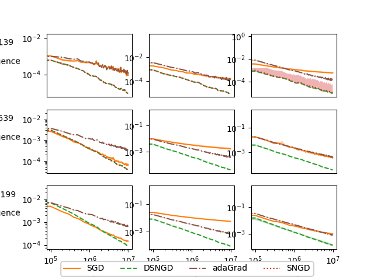

# Natural gradient based DSNGD in large dimension manifold 

This project implements a model for the classification problem
where a variable Y
is desired to be predicted after a variable X, by optimizing the 
log likelihhood function or the conditional Kullback-Leibler divergence. 
Implementation of optimization algorithm dsngd added as well as 
sgd, adagrad and sngd (adding more algorithms in the future).
The code found in this project is used to create the graphs appearing in my Ph.D Thesis with title: _Efficient 
and convergent natural gradient based optimization 
algorithms for machine learning_ and the research paper named _Dual Stockastic Natural Gradient Descent_.
### Running the default experiment
Clone the project and access the directory. Install packages appearing in requirements.txt. Finally,
execute _experiment.py_ coding file:
```bash
python3 bin/experiment.py
```
### Set up a new experiment
For a custom experiment with different settings open the _experiemnt.py_ file
and fill the variables with the desired values. Modifiable variables are:

```python
## Manifold related variables
y_values = 10  # Classes of discrete variable Y
xd_values = [7,6,7,2,7]  # Values of discrete variables  x_i in X assuming Naive Bayes
xg_values = 0  # Amount of x_i gaussian variables in X assuming Naive Bayes

## Algorithm related variables
algs = [sgd,  adagrad, dsngd, sngd] # A list of the algorithms to test
batch = 250  # Batch of sample fed to algorithm per iteration

## Sample related variables
sample_length = 100000  # Length of the sample
epochs = 1  # Repetitions of the sample
```



### Continuous and mixed features
The features of the Naive Bayes model can follow any of these exponential families, as described in
_Dual Stochastic Natural Gradient Descent for Continuous Exponential Families_:

- categorical, given by its number of values as in the discrete case (Bernoulli is `2`),
- `GaussianStatistic(variance)`: Gaussian with known variance,
- `GaussianMeanVarianceStatistic()`: Gaussian with unknown mean and variance,
- `PoissonStatistic()` and `ExponentialStatistic()`.

They can be mixed in the same feature vector, and all the algorithms (SGD, AdaGrad, DSNGD and SNGD) work with them.
SNGD uses the exact dual of the current parameters, so it needs them to stay inside the domain of the families (for
instance a negative natural parameter for the exponential family):

```python
from src.model.joint_mlr import JointMLR
from src.model.statistic import GaussianMeanVarianceStatistic, PoissonStatistic

model = JointMLR(10, [10, GaussianMeanVarianceStatistic(), PoissonStatistic()])
```

DSNGD only needs from each family the score in expectation coordinates (`dual_score`); categorical features keep
the original closed-form DSNGD terms, so the discrete case gives the same results as before. With continuous
features the error is the KL divergence between the true and the estimated conditional distributions, computed on a
Monte Carlo sample of x (exact over y).

### Running the experiments
Run the scripts from the root of the project with `PYTHONPATH=.` (or after `pip install -e .`). The synthetic
experiment keeps the default discrete setting, and `--features` selects other feature families on manifolds with
the same dimensions as M1, M2 and M3:

```bash
PYTHONPATH=. python bin/experiment.py --output outputs/discrete
PYTHONPATH=. python bin/experiment.py --features gaussian --output outputs/gaussian
```

`--features` can be `discrete`, `gaussian`, `gaussian-mv`, `poisson`, `exponential` or `mixed` (each 5-valued
feature replaced by Gaussian, Poisson and exponential features). The figure and the curves are saved in the given
path. The real data experiments use Covertype (continuous and categorical features) and MNIST (one Gaussian or
Bernoulli feature per pixel), downloaded to `saved_data/`:

```bash
PYTHONPATH=. python bin/experiment_real.py --dataset covertype --output outputs/covertype
PYTHONPATH=. python bin/experiment_real.py --dataset mnist --output outputs/mnist
```

Run the tests with `python -m unittest discover -s tests`.
