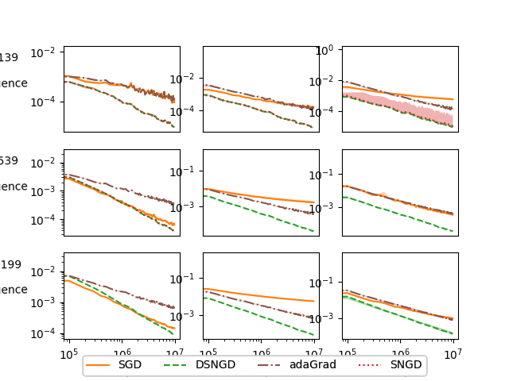

# Natural gradient based DSNGD in large dimension manifold 

This project implements a model for the classification problem
where a variable Y
is desired to be predicted after a variable X, by optimizing the 
log likelihhood function or the conditional Kullback-Leibler divergence. 
Implementation of optimization algorithm dsngd added as well as 
sgd, adagrad and sngd (adding more algorithms in the future).
The code found in this project is used to create the graphs appearing in my Ph.D Thesis with title: _Efficient 
and convergent natural gradient based optimization 
algorithms for machine learning_ and the research paper named _Dual Stockastic Natural Gradient Descent_.
### Running the default experiment
Clone the project and access the directory. Install packages appearing in requirements.txt. Finally,
execute _experiment.py_ coding file:
```bash
python3 bin/experiment.py
```
### Set up a new experiment
For a custom experiment with different settings open the _experiemnt.py_ file
and fill the variables with the desired values. Modifiable variables are:

```python
## Manifold related variables
y_values = 10  # Classes of discrete variable Y
xd_values = [7,6,7,2,7]  # Values of discrete variables  x_i in X assuming Naive Bayes
xg_values = 0  # Amount of x_i gaussian variables in X assuming Naive Bayes

## Algorithm related variables
algs = [sgd,  adagrad, dsngd, sngd] # A list of the algorithms to test
batch = 250  # Batch of sample fed to algorithm per iteration

## Sample related variables
sample_length = 100000  # Length of the sample
epochs = 1  # Repetitions of the sample
```



### Continuous and mixed features
The features of the Naive Bayes model can follow any of these exponential families, as described in
_Dual Stochastic Natural Gradient Descent for Continuous and Mixed Exponential Families_:

- categorical, given by its number of values as in the discrete case (Bernoulli is `2`),
- `GaussianStatistic(variance)`: Gaussian with known variance,
- `GaussianMeanVarianceStatistic()`: Gaussian with unknown mean and variance,
- `MultivariateGaussianStatistic(d)`: Gaussian vector of dimension `d` with unknown mean and covariance,
- `PoissonStatistic()` and `ExponentialStatistic()`,
- `GammaStatistic()`: Gamma with unknown shape and rate,
- `BetaStatistic()` and `DirichletStatistic(K)`: Beta on (0, 1) and Dirichlet on the simplex of dimension `K`,
- `VonMisesStatistic()`: von Mises distribution of an angle in radians.

Multivariate features (`MultivariateGaussianStatistic`, `DirichletStatistic`) take as many consecutive columns of the
data as their dimension. Features can be mixed in the same feature vector, and all the algorithms (SGD, AdaGrad, DSNGD
and SNGD) work with them.
SNGD uses the exact dual of the current parameters, so it needs them to stay inside the domain of the families (for
instance a negative natural parameter for the exponential family):

```python
from src.model.joint_mlr import JointMLR
from src.model.statistic import GaussianMeanVarianceStatistic, PoissonStatistic

model = JointMLR(10, [10, GaussianMeanVarianceStatistic(), PoissonStatistic()])
```

DSNGD only needs from each family the product of a vector by the Hessian of the conjugate of its log-partition at the
expectation parameter (`dual_hessian_product`), which gives the score in expectation coordinates and lets DSNGD compute
the direction of a mini-batch from the same sums of statistics as SGD. For the Gamma, Beta, Dirichlet and von Mises
families the natural parameters are recovered from the expectation parameters with a few Newton steps. The features of
each family are computed together: the sums of statistics of all the features come from one matrix product, and each
family applies its Hessian to all its features at once, so its methods take parameters with the components along the
first axis and any number of further axes. Categorical features use the same formula, which reproduces the discrete
results of the original implementation up to floating point rounding. With continuous
features the error is the KL divergence between the true and the estimated conditional distributions, computed on a
Monte Carlo sample of x (exact over y).

### Running the experiments
Run the scripts from the root of the project with `PYTHONPATH=.` (or after `pip install -e .`). The synthetic
experiment keeps the default discrete setting, and `--features` selects other feature families on manifolds with
the same dimensions as M1, M2 and M3:

```bash
PYTHONPATH=. python bin/experiment.py --output outputs/discrete
PYTHONPATH=. python bin/experiment.py --features gaussian --output outputs/gaussian
```

`--features` can be `discrete`, `gaussian`, `gaussian-mv`, `poisson`, `exponential`, `gamma`, `beta`,
`multivariate-gaussian`, `dirichlet` or `mixed` (each 5-valued feature replaced by Gaussian, Poisson and exponential
features). The figure and the curves are saved in the given
path. The real data experiments use Covertype and MNIST, downloaded to `saved_data/`, with `--features` choosing the model
of the features, and the learning rate search starts at initial rates of 10^-7 (`--min-lr-exponent`) instead of the
10^-4 of the synthetic experiments, since the best rates of DSNGD are smaller on these data. For Covertype, `natural` gives each variable a family according to its nature (Gaussian for elevation
and vertical distance, von Mises for the aspect, Gamma for the slope and the distances, Beta for the hillshade indices
and categorical for wilderness area and soil type) and `gaussian` uses Gaussians for all the continuous variables. For
MNIST, `levels` models each pixel as a categorical variable with 13 intensity levels (59,169 parameters, as LeNet-5,
whose accuracy is drawn on the figure), and `bernoulli` and `gaussian` model binarized or standardized pixels:

```bash
PYTHONPATH=. python bin/experiment_real.py --dataset covertype --features natural --output outputs/real/covertype_natural
PYTHONPATH=. python bin/experiment_real.py --dataset mnist --features levels --output outputs/real/mnist_levels
```

`bin/run_experiments.sh` runs all the experiments of the paper, `JOBS` at a time (6 by default), with `EXPERIMENTS`
repetitions of each synthetic problem (1 by default); a second argument `synthetic` or `real` runs only one part. Each
experiment writes one log line per training, with its result, the elapsed time and the expected remaining time.
`bin/summarize.py` prints the final errors, LaTeX rows for the tables of real data and computational time, and copies
the figures to `manuscript/figures`:

```bash
JOBS=6 EXPERIMENTS=1 bin/run_experiments.sh python synthetic
tail -n 1 outputs/synthetic/*.log
python bin/summarize.py
```

Run the tests with `python -m unittest discover -s tests`.
